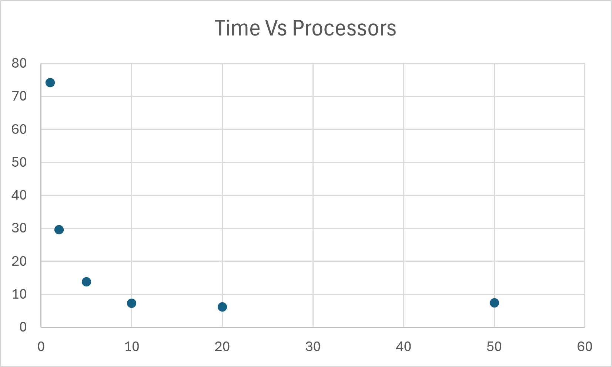

# Lab 11: Multiprocessing

**Author:** Mac Patterson
**Course:** CPE-2600

## Overview

`mandelmovie` makes 50 frames of a Mandelbrot zoom by running the `mandel` program
in several child processes at once. The `-p` option sets how many children can run
at the same time.

The parent loops through the frames and `fork()`s a child for each one. The child
`exec()`s `mandel` with that frame's zoom level. If `-p` children are already running,
the parent calls `wait()` until one finishes before starting the next. At the end it
waits for all remaining children.

To run it:
```bash
make
./mandelmovie -p 4
ffmpeg -framerate 10 -i mandel%d.jpg -r 25 -q:v 2 mandel.mpg
```

## Results

Time to make all 50 frames, measured with `time`:

| Processes | Runtime (s) |
|-----------|-------------|
| 1         | 74.0        |
| 2         | 29.5        |
| 5         | 14.0        |
| 10        | 7.5         |
| 20        | 6.0         |
| 50        | 7.5         |



## Discussion

More processes sped things up a lot at first, from 74 seconds with 1 process down to
7.5 seconds with 10. Each frame is independent, so each extra process could work on
a different frame on a different CPU core at the same time.

After about 10 processes the gains mostly stopped. Going to 50 processes was actually
slower than 20. Once every core is busy, extra processes just take turns on the same
cores, and switching between them adds overhead. So more processes only help up to
about the number of cores the computer has.

Lab 12: Multithreading

Implementation overview

mandel has a new -t <threads> option (1 to 20, default 1) that sets how many threads compute a single image. mandelmovie takes the same option and adds -t <threads> to the arguments it passes to mandel for each frame, so every child process it forks renders its frame with that many threads. All Lab 11 features are kept.

compute_image() splits the image into t horizontal bands of rows. If the height doesn't divide evenly, the leftover rows go one each to the first few threads. Each thread gets its own thread_args_t struct holding a pointer to the shared image, the complex-plane bounds, the max iteration count, and its row_start/row_end. A pointer to that struct is the single argument passed to pthread_create(). The thread function compute_region() runs the original nested pixel loop, limited to its own rows.

No mutexes are needed because the Mandelbrot calculation is embarrassingly parallel: each pixel depends only on its own coordinates, and each thread writes to a disjoint set of rows in the image buffer. The main thread pthread_join()s every worker before saving the JPEG, so the image is never written half finished.

The threads are created inside mandel after mandelmovie has already forked and exec'd it, so a process never forks while it has multiple threads running.

Runtime results

Time in seconds to generate 50 frames (1000x1000, max 1000 iterations, Seahorse Valley zoom). Each cell is a single run.

Machine: Intel Core Ultra 5 125U laptop running Ubuntu under WSL. 14 logical CPUs, made of 2 P-cores with hyperthreading (4 threads), 8 E-cores, and 2 low-power E-cores.

Procs \ Threads	1	2	5	10	20
1	159.807	88.688	46.306	28.926	24.728
2	66.781	46.070	26.288	22.518	21.753
5	33.466	25.717	22.163	21.313	20.848
10	23.256	21.975	21.366	20.910	21.108
20	21.437	22.080	21.410	21.818	23.395
Discussion

Which technique impacted runtime more, multithreading or multiprocessing? Why?

Multiprocessing had the bigger impact. Comparing the first column (processes only) to the first row (threads only) at the same count, processes win every time:

Count	Processes only	Threads only
2	66.8 s (2.4x)	88.7 s (1.8x)
5	33.5 s (4.8x)	46.3 s (3.5x)
10	23.3 s (6.9x)	28.9 s (5.5x)
20	21.4 s (7.5x)	24.7 s (6.5x)

There are two reasons:

Uneven work between threads. Splitting a frame into equal bands of rows doesn't split the work equally. Rows through the middle of the set run to the max iteration count, while rows near the edges escape after a few iterations. A frame isn't finished until its slowest band is done, so the threads with easy bands sit idle while one thread finishes the hard part. Processes each do a whole frame, so each one stays busy from start to finish.
Threading only speeds up the math. Each frame still has to be JPEG-compressed and written to disk, and that happens on a single thread after compute_image() returns. With 1 process and many threads, all 50 of those encodes happen one after another. With multiple processes, they overlap.

The 2-process run being more than twice as fast as 1 process (2.4x) is probably a hybrid-core effect. WSL doesn't know which cores are P-cores and which are E-cores, so a lone single-threaded process may spend time on a slower E-core. Since each cell is a single run, I wouldn't read too much into that one number.

Was there a "sweet spot" where runtime was minimal?

Yes. The fastest run was 5 processes x 20 threads at 20.85 s, about 7.7x faster than 1 process x 1 thread. But results flatten out once there are enough workers to cover the 14 logical CPUs with some extra: 10 x 10 (20.91 s), 10 x 20 (21.11 s), 5 x 10 (21.31 s) and 20 x 1 (21.44 s) are all within about half a second. That's close enough that the run-to-run noise could change which one is first, so the sweet spot is really this plateau, roughly 50 to 200 total threads (processes x threads).

Going somewhat past 14 workers still helps because more, smaller pieces of work let the OS keep every core busy until the end, which covers for the uneven bands and the mix of fast and slow cores. Going too far hurts: 20 x 20 (400 threads) took 23.4 s, slower than the plateau, because of the overhead of creating and switching between that many threads.

The floor is about 21 s instead of 160 / 14 = 11.4 s because the 14 logical CPUs aren't equal. Only 4 are P-core threads, and those are 2 cores shared through hyperthreading. The E-cores and low-power E-cores are slower, and a 15 W laptop chip can't hold its top clock speed with every core loaded.