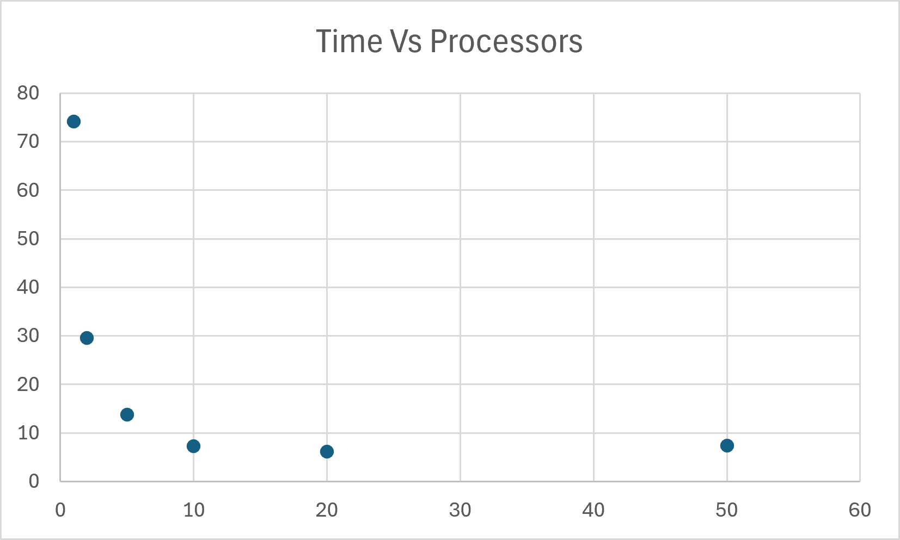

# Lab 11: Multiprocessing

**Author:** Mac Patterson
**Course:** CPE-2600 Systems Programming
**Date:** 11/12/2026

## Overview

`mandelmovie` generates the 50 frames of a zoom into the Mandelbrot set by running the
`mandel` program many times in parallel. Each frame is rendered by its own child
process, and the number of children allowed to run at the same time is set on the
command line with `-p`. The frames are then stitched into `mandel.mpg` with ffmpeg.

### How it works

1. `main()` parses the command line with `getopt` (`-p` processes, `-n` frames, plus
   center, starting scale, zoom factor, image size and max iterations).
2. The parent loops over the frames. For each frame it:
   - checks how many children are running. If all `-p` slots are busy, it calls
     `wait()` and blocks until any one child finishes, then reuses that slot.
   - calls `fork()`. The child calls `execl("./mandel", ...)` with that frame's scale
     and an output name of `mandel<N>.jpg`.
   - multiplies the scale by the zoom factor (default 0.82) so each frame is a fixed
     fraction of the previous one. This keeps the zoom speed steady.
3. After the last frame is launched, the parent waits for every remaining child before
   exiting, and reports an error if any child did not exit cleanly.

The children never need to communicate, so no pipes or shared memory are used.
Changes to `mandel.c`: a 16 color palette in `iteration_to_color()` (the original gray
scale left most of the image nearly black), input validation, and storing `getopt`'s
return value in an `int` instead of a `char`.

### Building and running

```bash
sudo apt install libjpeg-dev ffmpeg
make
./mandelmovie -p 4      # 50 frames, 4 processes at a time
./mandelmovie -h        # all options
ffmpeg -framerate 10 -i mandel%d.jpg -r 25 -q:v 2 mandel.mpg
```

The zoom target is (-0.743643887037151, 0.131825904205330) in Seahorse Valley,
starting at a scale of 4 and ending near 0.00024 after 50 frames.

## Results

Time to generate all 50 frames (1000x1000 pixels, max 1000 iterations), measured with
`time` on a machine with **N** CPU cores:

| Processes | Runtime (s) |
|-----------|-------------|
| 1         | 74.0        |
| 2         | 29.5        |
| 5         | 14.0        |
| 10        | 7.5         |
| 20        | 6.0         |
| 50        | 7.5         |



## Discussion

Adding processes made a large difference at first. Runtime dropped from 74 seconds with
one process to 7.5 seconds with 10, roughly a 10x improvement. Each frame is independent
and purely CPU bound, so every extra process put another core to work on a different
frame at the same time.

The gains shrank as the process count went up. Going from 10 to 20 processes only saved
about 1.5 seconds, and going from 20 to 50 actually made it slower, 7.5 seconds instead
of 6. Once every core is busy, extra processes do not get any more hardware. They just
take turns on the same cores, and the operating system has to switch between them, which
adds overhead. Each frame also pays a fixed cost to `fork()` and `exec()` a new process.

The speedup is not perfectly even, partly because the frames do not take equal time.
Frames deep in the zoom contain more points inside the set, and those points run all
1000 iterations. Near the end of a run, some cores sit idle while the last slow frames
finish.

So more processes do not always make it faster. The best results came from roughly one
process per core, and going far past that made the program slower.